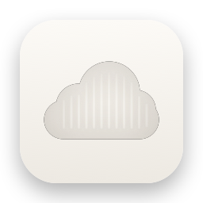

<p align="center">
  
</p>

# CloudPlayer

A **100% pure-Swift, native macOS** player for SoundCloud, built with SwiftUI, `AVFoundation`, and SoundCloud's `api-v2` — optimized for macOS 26/27 Liquid Glass (requires macOS 14 or later).

> Unofficial. Not affiliated with or endorsed by SoundCloud.

## Highlights

- **Zero persistent WebKit (~100 MB RAM):** No embedded browser engine runs during playback or browsing. A disposable, non-persistent `WKWebView` sheet is used *only* when signing in and is torn down immediately afterward.
- **Native `AVFoundation` playback:** Direct HLS/MP3 streaming, reorderable Up Next queue with Autoplay similar tracks, Shuffle & Repeat, `MPNowPlayingInfoCenter` + media keys, Spacebar Play/Pause, Menu Bar controls, floating Mini Player (`⇧⌘M`), and live `/me/play-history` sync.
- **Native macOS 26/27 Liquid Glass UI:** Home mixes, Likes (Tiles / Compact / Waveform, full-library filter & metadata sort), Playlists & Albums, Stations, Following, History, Search with live tag facets & filters, Track Detail with Canvas waveforms & timed avatar comments, Artist Profiles with banners & curated shelves, Settings (`⌘,`), and full-window Focus Mode.
- **Fast & lightweight:** Nuke image caching, stale-while-revalidate disk/memory API cache, lazy-loaded related tracks, and neighbor track prefetching.

## Install

```sh
curl -fsSL https://raw.githubusercontent.com/rzachulec/CloudPlayer/main/install.sh | bash
```

To test the latest staging (`nightly`) build from `main` before it is promoted to a versioned release:

```sh
curl -fsSL https://raw.githubusercontent.com/rzachulec/CloudPlayer/main/install.sh | bash -s -- --nightly
```

This downloads the right build for your Mac, quits CloudPlayer if it's running, puts it in
`/Applications`, and opens it. Run it again any time to update; you stay signed in, because your
SoundCloud session lives in your Keychain / `~/Library`, not inside the app. Read [`install.sh`](install.sh)
first if you like: it's short. Options go before `bash` (e.g. `… | CLOUDPLAYER_DIR=~/Applications bash`,
`CLOUDPLAYER_NO_LAUNCH=1`, `CLOUDPLAYER_CHANNEL=nightly`) or after `bash -s --` (`--nightly`,
`--version v0.1.0`).

## Download & Releases

- **Stable releases** (`v*`): published on [Releases](../../releases/latest) with auto-generated changelogs (see [`CHANGELOG.md`](CHANGELOG.md)).
- **Nightly / staging builds**: every push to `main` runs the unit test suite, builds both Mac architectures, signs them with a self-signed certificate, and updates the rolling [**nightly** pre-release](../../releases/tag/nightly).

| Mac | File |
| --- | --- |
| Apple Silicon (M1 and newer) | `CloudPlayer-macos-apple-silicon.zip` |
| Intel | `CloudPlayer-macos-intel.zip` |

## Running a self-signed app from Terminal

The builds are signed with a self-signed certificate, not an Apple Developer ID, and are not
notarized. When you download one in a browser, macOS marks it as quarantined and Gatekeeper
refuses to open it ("CloudPlayer can't be opened because Apple cannot check it for malicious
software"). Removing the quarantine flag lets it run.

The [install command](#install) does this for you. **Step by step**, if you already downloaded the zip in your browser:

```sh
cd ~/Downloads

# 1. Unzip (ditto keeps the code signature intact)
ditto -x -k CloudPlayer-macos-apple-silicon.zip .     # or CloudPlayer-macos-intel.zip

# 2. Remove the quarantine flag macOS added to the download
xattr -dr com.apple.quarantine CloudPlayer.app

# 3. (Optional) move it to Applications
mv CloudPlayer.app /Applications/

# 4. Launch
open /Applications/CloudPlayer.app
```

To check the signature:

```sh
codesign -dvv /Applications/CloudPlayer.app   # shows "Authority=CloudPlayer Self-Signed"
codesign --verify --deep --strict /Applications/CloudPlayer.app && echo "signature OK"
```

> Only remove the quarantine flag from apps whose source you trust. You can read the code in
> this repo and the exact build steps in [`.github/workflows/_build.yml`](.github/workflows/_build.yml).

## Building & Testing Locally

```sh
# Run unit tests (Debug)
xcodebuild -project CloudPlayer.xcodeproj -scheme CloudPlayer -configuration Debug \
  -derivedDataPath build test

# Build Release app
xcodebuild -project CloudPlayer.xcodeproj -scheme CloudPlayer -configuration Release \
  -derivedDataPath build build
open build/Build/Products/Release/CloudPlayer.app
```

Or open `CloudPlayer.xcodeproj` in Xcode and press **⌘R** (or **⌘U** for tests).

### Regenerating the app icon

The icon is drawn in code. To change it, edit `tools/gen_icon.swift` and run:

```sh
swift tools/gen_icon.swift CloudPlayer/Assets.xcassets/AppIcon.appiconset
```
